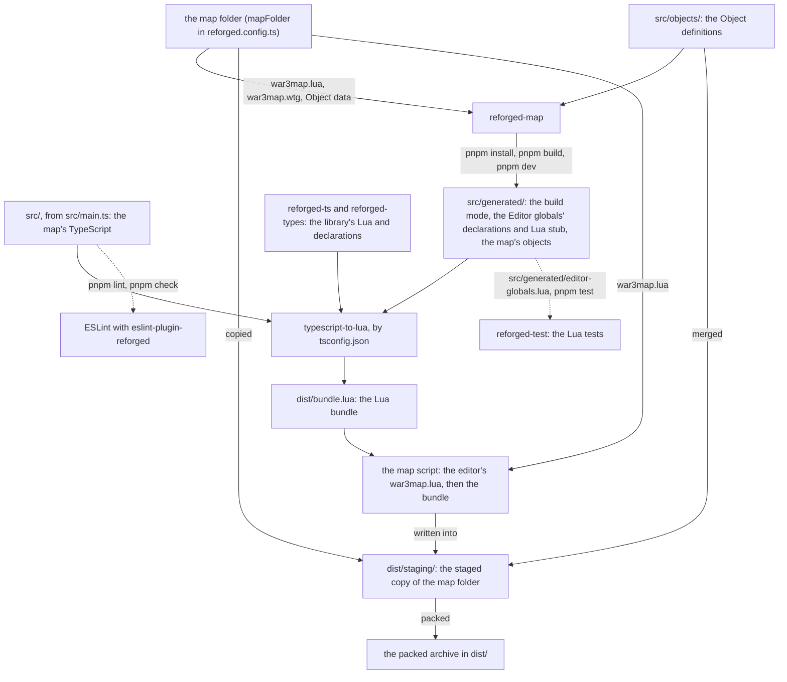

# reforged-ts-template

A Map project template: a Warcraft III 3.0.0 map whose code is TypeScript compiled to Lua with typescript-to-lua and [reforged-ts](https://github.com/phmilk/reforged-ts). You write the map's code in `src`, `pnpm build` appends it to the script the World Editor saved and packs the map, and `pnpm test:map` opens it in the game. The World Editor owns the map's data (terrain, object data, placed units); this repository owns the code, and the types of object it declares as [Object definitions](#object-definitions). The way the build works (the editor's map folder, the code appended to its script, the archive packed) comes from cipherxof's [wc3-ts-template](https://github.com/cipherxof/wc3-ts-template) (MIT).

**Status: under construction.** The Template is being built in the open specs of its issue tracker, at https://github.com/phmilk/reforged-ts-template/issues. The library packages are published as alphas under npm's `next` dist-tag (see [the library packages](#the-library-packages)); the documentation site is not live yet: its links, the `llms.txt` one included, are placeholders until it is.

## Requirements

- **Warcraft III 3.0.0** with a Battle.net login saved on the machine: `pnpm test:map` starts the game with the flag that reuses it.
- **The World Editor**, which ships with the game. The map is saved as a folder, with Lua as its script language.
- **Node 24** (`.node-version`).
- **pnpm 12** (`packageManager` in `package.json`): install it with `npm install --global pnpm@12`. pnpm 11 or later switches to the pinned version by itself; pnpm 10 cannot start pnpm 12 on Windows. Its settings live in `pnpm-workspace.yaml`.
- **Git**, to clone the repository, or for the Creation CLI's first commit.

On Linux the game runs through Wine: set `winePath` in `reforged.config.ts`.

## First run

The Creation CLI, [`create-reforged-map`](https://github.com/phmilk/reforged-ts/tree/master/packages/create-reforged-map), makes a Map project from the Template in one command. Run it from the folder to create the project in; it makes the project's own folder, `my-map` here:

```sh
npx create-reforged-map@next my-map   # or: pnpm create reforged-map@next my-map
cd my-map
```

In a terminal it asks for the project name, the folder's name when left blank, and a one-line description of the map. Then it downloads the Template into `my-map`, writes the name into `package.json` and this README, names the map folder after it (`my-map.w3m`, at the project root) and points `mapFolder` in `reforged.config.ts` at it, writes the description, when given, there and into `AGENTS.md`'s "Your project", makes the folder a git repository, installs the packages, runs `pnpm template:detach` to remove the files that serve only the Template's own development, and makes a first commit. It needs pnpm, and git unless `--skip-git`; [its README](https://github.com/phmilk/reforged-ts/tree/master/packages/create-reforged-map#usage) lists the other options. Write `@next` until 1.0.0: npm keeps `latest` on the first alpha, so a bare `npx create-reforged-map` runs that one.

The other way in is GitHub's **Use this template**, which shows your repository as generated from the Template:

1. Create your repository from this one with **Use this template**.
2. Clone it and open a terminal in the clone.
3. Name the map: rename the map folder, `reforged-ts-template.w3m` at the root, after your project (`my-map.w3m`), and set `mapFolder` in `reforged.config.ts` to the new name.
4. Install: `pnpm install`. To build against a local checkout of the library instead, run `pnpm use:local <checkout>` ([below](#developing-against-a-local-checkout-of-the-library)).
5. Detach: run `pnpm template:detach` once, and commit what it deletes: the files that serve only the Template's own development ([below](#deletable-in-a-generated-project)).

Either way, the install wrote the generated files under `src/generated`; after the CLI's `--skip-install`, run `pnpm install` first. Then:

1. Open the map folder, at the project root beside `src` (`my-map.w3m`; `reforged-ts-template.w3m` in the Template itself), in the World Editor and save it. Leave Scenario > Map Options > Script Language on Lua: the build appends the map's code to the script the editor writes. To rename the map, save it at the root with the new name and set `mapFolder` in `reforged.config.ts`.
2. Build: `pnpm build`. It prints the packed archive, `dist/my-map-0.0.0-dev.w3m` (`dist/reforged-ts-template-0.0.0-dev.w3m` in the Template itself): the map folder's name without its suffix, the `version` of `package.json`, and `-dev` for a dev build. `pnpm build --mode release` packs `dist/my-map-0.0.0.w3m`, the archive you ship. `pnpm version patch` (or `minor`, `major`) bumps the version and tags the commit.
3. Play: `pnpm test:map` builds, then opens the game on the packed archive, windowed. To pick the map from the game's own map list instead, copy the archive into the game's Maps folder.
4. Iterate: `pnpm dev` rebuilds on every change under `src` or the map folder, until Ctrl+C.
5. Define objects in code, when it suits: [Object definitions](#object-definitions).

`pnpm test:map` finds the game in the Battle.net install locations. When the game lives elsewhere, set the `WC3_EXECUTABLE` environment variable to its executable (and `WINEPREFIX` for a Wine prefix) rather than writing the path into `gameExecutable`: `reforged.config.ts` is committed, so it holds only what every machine shares. `pnpm test` fails when a committed file holds an absolute path (`tests/pipeline/absolute-paths.test.ts`), because such a path works on one machine only. The check reads the files as committed in `HEAD`, so a local setting you do not commit never fails it.

## Commands

| Command                     | What it does                                                                                                      |
| --------------------------- | ----------------------------------------------------------------------------------------------------------------- |
| `pnpm build`                | Builds the map in dev mode, the library's runtime checks on, into `dist/<map>-<version>-dev.<suffix>`.            |
| `pnpm build --mode release` | Builds the map in release mode, the runtime checks off, into `dist/<map>-<version>.<suffix>`: the build you ship. |
| `pnpm dev`                  | Watches `src` and the map folder and rebuilds on every change.                                                    |
| `pnpm test:map`             | Builds, then launches the game on the packed archive.                                                             |
| `pnpm test`                 | Runs the tests without the game: the build scripts' in Node, the map's on the Lua 5.3 harness.                    |
| `pnpm check`                | Runs `lint`, `typecheck` and `test` in that order and stops at the first failure: the definition of done.         |
| `pnpm objects:sync`         | Writes the Object definitions of `src/objects/` into the map folder and the Object manifest.                      |
| `pnpm objects:adopt`        | Hands objects of the map folder to the code (`<rawcode...>` or `--all`), as definition files.                     |
| `pnpm objects:release`      | Hands objects the code owns back to the map folder (`<rawcode...>`), deleting their definition files.             |

The archive's name is the map folder's name without its suffix, then the `version` of `package.json` (left out when there is none), then `-dev` for a dev build, then the map folder's suffix; `archiveName` in `reforged.config.ts` replaces it, used as written. `pnpm test:map` launches that archive: since Patch 3.0.1 the game no longer opens a map folder given to `-loadfile`, only a packed map (phmilk/reforged-ts#642).

`pnpm lint` and `pnpm lint:fix` run ESLint alone ([Lint](#lint)), `pnpm typecheck` the TypeScript compiler alone, and `pnpm use:local <checkout>` installs the library from a local checkout ([below](#developing-against-a-local-checkout-of-the-library)).

## Toolchain

How the map's TypeScript becomes the map script inside the packed archive. `pnpm build` runs the solid edges once, in the order of `scripts/build.ts`: stage the map folder, merge the Object definitions, write `src/generated/`, compile, compose the map script, pack. `pnpm dev` runs them again on every change, and `pnpm install` writes `src/generated/` without building. The dashed edges are no step of the build: lint checks the source, and the Lua tests load the stub of the Editor globals.



| Node                             | Read                                                                                                   |
| -------------------------------- | ------------------------------------------------------------------------------------------------------ |
| the map folder                   | [First run](#first-run); `mapFolder` in `reforged.config.ts`                                           |
| `src/objects/`                   | [Object definitions](#object-definitions); the merge, `mergeObjects` in `scripts/objects.ts`           |
| `src/`                           | the entry point, `src/main.ts`                                                                         |
| `reforged-map`, `src/generated/` | [Generated files](#generated-files); the writers, `GENERATORS` in `scripts/generate.ts`                |
| `reforged-ts`, `reforged-types`  | [The library packages](#the-library-packages)                                                          |
| typescript-to-lua                | `compileBundle` in `scripts/compile.ts`; `tstl.luaBundle` and `tstl.luaBundleEntry` in `tsconfig.json` |
| ESLint                           | [Lint](#lint); `eslint.config.mjs`                                                                     |
| the staged copy                  | `stageMapFolder` in `scripts/stage.ts`                                                                 |
| the map script                   | `composeMapScript` in `scripts/compose.ts`                                                             |
| the packed archive               | [Commands](#commands), for its name; `packMapFolder` in `scripts/pack.ts`                              |
| `reforged-test`                  | `tests/harness/compile.ts`, which writes `src/generated/` before the Lua tests compile                 |

## Generated files

Every install, build and watch (`pnpm dev`) rewrites `src/generated/`, ignored by git and read-only in the editor:

- `env.ts`: the build mode, `devMode`, from `--mode` or `mode` in `reforged.config.ts`.
- `editor-globals.d.ts` and `editor-globals.lua`: the Editor globals, the `gg_` and `udg_` globals the World Editor declares for the map, as TypeScript declarations for the map's code and a Lua stub for the test harness. [`reforged-map`](https://github.com/phmilk/reforged-ts/tree/master/packages/reforged-map) declares them from the map folder's `war3map.lua` and `war3map.wtg`. A GUI variable of an object type is typed by its Object kind, read from its type in the Variable Editor: a Unit-Type `udg_SpawnType` is a `Rawcode<"unit">`, so `CreateUnit(owner, udg_SpawnType, …)` compiles with no cast. To add, rename or retype one, change it in the World Editor and save the map.
- `map-objects.d.ts` and the constants modules `custom-units.ts`, `custom-items.ts`, `custom-abilities.ts`, `custom-buffs.ts`, `custom-destructables.ts`, `custom-doodads.ts` and `custom-upgrades.ts`: the map's objects, which `reforged-map` reads from the map folder's Object data (`war3map.w3u` to `war3map.w3q` and their `war3mapSkin` counterparts, the names through `war3map.wts`). `map-objects.d.ts` declares a `FourCC` overload per Custom object and per Built-in object the map modifies, so `FourCC("h000")` is a `Rawcode<"unit">` with the object's name on hover. Each constants module names the Custom objects of its Object kind by name and Rawcode: `CustomUnits.Captain_h000`, imported from `./generated/custom-units`; a kind the map has none of gets an empty one. A Custom object that keeps its base's name is named after the base, read from `reforged-builtins`. To add or rename one, change it in the Object Editor and save the map: the constant follows the name, and each use of the old name stops compiling. They include the objects the code defines ([Object definitions](#object-definitions)), named from the definition's name field, whose hover names the definition's file.

## Object data in `git diff`

The map folder's Object data files (`war3map.w3u` to `war3map.w3q` and their `war3mapSkin` counterparts) are binary, yet `git diff` of a change made in the Object Editor shows which object and which field it changed, with the old and the new value:

```diff
@@ -6,5 +6,5 @@ custom h000 from hfoo
   uhpm int = 800
   umpm int = 100
   udef int = 4
-  umvs int = 300
+  umvs int = 320
   usid int = 1200
```

Each file is shown as text by [`reforged-map`](https://github.com/phmilk/reforged-ts/tree/master/packages/reforged-map#object-data-in-git-diff)'s `textconv` driver. One line per object names its table and its Rawcode, `builtin hfoo` for a Built-in object the map modifies or `custom h000 from hfoo` for a Custom object and its base; under it, indented, one line per modification gives the field id, its value type, its level and data pointer for abilities, doodads and upgrades, then `=` and the value. git's hunk header names the object above the change. A `TRIGSTR_nnn` value is a string of `war3map.wts`, which is text: its own diff shows the string whose text changed.

`.gitattributes` names the driver on the Object data files and keeps every byte of the map folder as the World Editor wrote it, whatever `core.autocrlf` says. The driver's command is local to each clone, since git never takes a command from a repository's files: `pnpm install` sets it (`scripts/diff-driver.ts`, run by `prepare`) in the clone's `.git/config`, with `diff.reforged-object-data.cachetextconv` so each version of a file is converted once. Without git, outside a git work tree, or when git cannot write its configuration, the install warns and goes on, and `git diff` says "Binary files differ" until the next `pnpm install`.

## Object definitions

An Object definition declares one of the map's types of object in TypeScript instead of the Object Editor: a new Custom object, or a change to a Built-in object. The code then owns it, and the World Editor still shows it. The library's guide, [Object definitions](https://phmilk.github.io/reforged-ts/docs/next/guides/object-definitions), gives every rule; [`reforged-map`'s README](https://github.com/phmilk/reforged-ts/tree/master/packages/reforged-map#object-definitions) every detail.

```ts
// src/objects/unit/Sergeant_h002.ts
import { defineUnit } from "reforged-map/objects";

export const Sergeant_h002 = defineUnit({
  rawcode: "h002",
  base: FourCC("hfoo"),
  fields: { unam: "Sergeant", uhpm: 520 },
});
```

- **The folder.** `src/objects/` holds the definitions, one exported `define<Kind>` call of `reforged-map/objects` per object, by field id (`uhpm`; its hover gives the Object Editor's label). Adoption lays them out as `src/objects/<kind>/<Name>_<rawcode>.ts`. They are Node modules the build loads, never part of the map's Lua: the map's `tsconfig.json` and the Lua tests' leave the folder out, and `tsconfig.objects.json`, which `pnpm typecheck` runs, type-checks it with the Typings' `FourCC` and Rawcode types, the generated `map-objects.d.ts` and `reforged-map/objects`. ESLint lints it with that project, `reforged/no-unknown-rawcodes` included. A definition names another object with `FourCC("A001")`: the generated constants and those of `reforged-builtins` exist only in the map's Lua.
- **The build's merge.** `pnpm build` merges every definition into its staged copy of the map folder, after staging and before packing, so `dist/` holds them without a sync; the map folder and the manifest are only read. Its warnings go to stderr; a collision with an object the map folder defines, or an invalid definition, fails the build naming the file, the Rawcode and the field. The generated constants and overloads include the objects defined in code (`CustomUnits.Sergeant_h002`).
- **`pnpm objects:sync`** writes the definitions into the map folder itself, in the form the World Editor saves, so that the World Editor and `git diff` show them, and records them in the manifest. A second sync writes nothing. It prints its report and exits non-zero when it refuses, writing nothing: an invalid definition, a collision (adopt the object, or choose another Rawcode), an owned object changed outside the code (copy each change listed into its definition, or `--force` to overwrite them), unsaved edits in the World Editor, or a manifest it cannot read.
- **`pnpm objects:adopt <rawcode...>`**, or `--all`, hands objects made in the World Editor to the code: each gets a definition file, formatted with the project's Prettier, and an entry in the manifest; the map folder is left byte for byte. A Rawcode two kinds share names its kind: `buff:B000`.
- **`pnpm objects:release <rawcode...>`** hands objects back: each is synced one last time, then leaves the manifest, and its definition file is deleted, its placements on the terrain kept. Deleting a definition instead removes its object at the next sync, and its placements at the World Editor's next save.
- **The Object manifest**, `object-manifest.json` at the root, records what the code owns and what the last sync wrote of each object. It is committed, written only by the three commands, never by hand; `.prettierignore` leaves it as `reforged-map` writes it. A merge conflict in it is resolved by keeping both sides' entries, then `pnpm objects:sync`.
- **In `pnpm dev`**, `devObjectSync: true` in `reforged.config.ts` (off by default) runs Object sync before each build and watches the manifest too; a refused sync is printed, and the build still runs with the definitions merged.

Each command takes `--force`, which overrides only what that command's refusal says it may. **Take turns with the World Editor**: it keeps the map it loaded in memory and its next save writes all of it back, so save or discard its edits before a sync, an adoption or a release; a window title ending in ` *]` refuses them. After a sync that writes the map folder, a World Editor holding the map without unsaved edits is reloaded with `World Editor.exe -launch -loadfile <map folder>`, the executable beside the game `pnpm test:map` finds; when the game is not found, the sync warns to reload the map by hand (File > Open). Edit an owned object in code, not in the Object Editor. Everything else in the map folder (terrain, placed units, triggers, the map's options) changes only through the World Editor.

## Compatibility matrix

Which versions of the six library packages, which game Patch and which Toolchain go together. The block is generated at each library release and pasted here by the sync workflow: do not edit it by hand.

<!-- reforged-ts:matrix:start -->

<!-- Generated by `pnpm release:matrix` from release/compatibility/matrix.json; do not edit. -->

No stable release yet. During the build phase the packages are published as `1.0.0-alpha.N` under the `next` dist-tag.

<!-- reforged-ts:matrix:end -->

## For AI agents

<!-- reforged-ts:docs:start -->

**For AI agents:** the documentation of the pinned library version, as one plain-text file for a language model, is [llms.txt](https://phmilk.github.io/reforged-ts/docs/next/llms.txt).

<!-- reforged-ts:docs:end -->

## Agents and editor

`AGENTS.md` tells any coding agent how this project is worked on: the commands, the layout, the runtime constraints of the game's Lua, lint and testing; `CLAUDE.md` imports it for Claude Code. `GLOSSARY.md` is the project's glossary: the library's terms first, then a section for your map's own. The Agent skills under `.claude/skills` walk an agent through adding a feature (`map-feature`) and running the map in the game (`run-in-game`); `AGENTS.md` lists them, so an agent without skills reads them as documents.

A green `pnpm check` is the definition of done, for an author and for an agent.

`.vscode/` holds the workspace settings, the recommended extensions (ESLint, Prettier, the Lua language server) and the tasks. `build` is the default build task (Ctrl+Shift+B) and `test` the default test task; `build: release`, `dev` (a background watch), `test:map` and `check` are under "Tasks: Run Task". Build errors and lint problems land in the Problems panel. The editor saves on focus change, then formats and applies ESLint's fixes; it diagnoses with the TypeScript under `node_modules` and keeps the map folder and `src/generated` read-only. `.editorconfig` gives other editors and agents the same whitespace: UTF-8, LF, two spaces, a final newline, no trailing whitespace outside Markdown.

Hovering a Rawcode literal, the `"h000"` of `FourCC("h000")` or a number cast to a Rawcode, shows the object it names (its name, Object kind, origin, base, race and Game data sets), and go to definition goes to its constant. Both come from `reforged-map`'s TypeScript plugin, which `tsconfig.base.json` enables and which reads the map folder at the project root as the World Editor saves it, with no build (a project whose map folder is still under `maps/` keeps its hover until 1.0.0). The editor must run the workspace TypeScript: in VS Code, "TypeScript: Select TypeScript Version" then "Use Workspace Version", which the workspace settings prompt for. VS Code's TypeScript 7 extension loads no plugin; the generated overloads still give a Custom object's name on hover. See [Hover and go to definition on a Rawcode literal](https://phmilk.github.io/reforged-ts/docs/next/guides/rawcodes#hover-and-go-to-definition-on-a-rawcode-literal).

## Lint

`pnpm lint` runs ESLint over the repository (the map's source, its Lua tests, the build scripts and their tests) and fails on any problem, warnings included; `pnpm lint:fix` applies the fixes and formats. The flat config in `eslint.config.mjs` holds:

- the library's base stack: `@eslint/js` recommended, typescript-eslint's strict and stylistic type-checked presets through the project service, and `eslint-plugin-import-x` with the TypeScript resolver;
- every recommended rule of [`eslint-plugin-reforged`](https://github.com/phmilk/reforged-ts/tree/master/packages/eslint-plugin-reforged), the lint layer of the library's runtime checks, on the code that runs in the game (`src` and `tests/lua`); each problem links to its rule's page;
- Prettier as an ESLint rule, with the config in `.prettierrc` (Prettier 3's defaults), so the editor and `pnpm lint` format alike.

A rule is silenced on one line only, with the reason after `--`; a disable comment without one is an error:

```ts
// eslint-disable-next-line reforged/no-unsafe-natives -- runs in a trigger action, where the sleep is safe
TriggerSleepAction(1);
```

The type-aware rules find each file's program through the nearest `tsconfig.json`. The Node side (`scripts`, `tests/pipeline`, `tests/harness` and the configuration files) is typed by `tsconfig.scripts.json`, and the Object definitions (`src/objects`) by `tsconfig.objects.json`, which no `tsconfig.json` names; the map's `tsconfig.json` references both through `tsconfig.solution.json`, a solution file that compiles nothing, so ESLint and the editor both find them. `src/objects` gets only the rule `reforged/no-unknown-rawcodes` of `eslint-plugin-reforged`: the others guard code that runs in the game.

## The library packages

The Template depends on six packages of [phmilk/reforged-ts](https://github.com/phmilk/reforged-ts): `reforged-ts` and `reforged-types` (the map's code), `reforged-test` (the Lua test harness), `eslint-plugin-reforged` (the lint rules), `reforged-map` (the map folder reader the build calls to write `src/generated`) and [`reforged-builtins`](https://github.com/phmilk/reforged-ts/tree/master/packages/reforged-builtins) (the Built-in objects of the Patch: their constants, `Units.Footman_hfoo` from `reforged-builtins/units`, and the index `reforged-map` reads for base names). `package.json` declares the six the same way, as caret ranges on the latest released versions, which the Template's sync sets on each library release. They are on the `next` channel, each at a caret range on its latest alpha (`^1.0.0-alpha.N`).

### The Built-in objects' overloads

`reforged-builtins` also declares a `FourCC` overload per Built-in object, which types `FourCC("hfoo")` as a `Rawcode<"unit">` and completes the Built-in Rawcodes inside `FourCC("")`. The Template leaves them off: they cost 6.6 to 7.0 ms of type-check time per literal `FourCC` call (about 7 seconds per thousand calls, in the editor and in `pnpm typecheck`), and nothing at run time. A literal they do not cover stays an `UnknownRawcode`, which every Rawcode parameter accepts, and the constants import either way at no check-time cost. To turn them on, add the entry of the Game version to `types` in `tsconfig.base.json`:

```jsonc
"types": ["@typescript-to-lua/language-extensions", "reforged-types/3.0.0", "reforged-builtins/3.0.0"]
```

The map's own overloads in `src/generated/map-objects.d.ts` still win for a Built-in object the map modifies, so its hover gives the map's name.

During the build phase the library publishes its packages as `1.0.0-alpha.N` under npm's `next` dist-tag. The committed lockfile pins the versions a fresh `pnpm install` gets from the registry. To try a library change before it is published, use a local checkout of the library (below).

### Developing against a local checkout of the library

To try a change to reforged-ts in the game before any package is published, point the project at a local checkout of [phmilk/reforged-ts](https://github.com/phmilk/reforged-ts):

```sh
pnpm use:local ../reforged-ts   # build, pack and install the six library packages from the checkout
pnpm build                      # or pnpm test, pnpm test:map
pnpm use:local --reset          # back to the registry versions
```

`pnpm use:local <path>` runs the checkout's build for the six packages (`eslint-plugin-reforged` included, so `pnpm lint` runs the checkout's rules), packs them into `.local-packages/` (ignored by git) and installs them in place of the registry versions. It works on a fresh clone with no `node_modules`. Rerun it after changing the library to pick up the change.

Nothing committed changes, in either direction: the committed pnpm hook `.pnpmfile.cjs` swaps the six packages for their tarballs only while `.local-packages/packages.json` exists, and neither command writes the lockfile: `use:local` installs without it (`--no-lockfile`) and `--reset` reinstalls from the committed one (`--frozen-lockfile`). `git status` stays clean after `use:local` and after `--reset`. While the local packages are in use, reinstall with `pnpm use:local` rather than a plain `pnpm install`, which sees no change to the manifests and keeps the tarballs it installed last.

## Deletable in a generated project

This repository keeps the Template itself up to date with the library. A Map project generated from it deletes that machinery with `pnpm template:detach`, which the Creation CLI runs for it. The command removes the files `template-maintenance.json` lists, this section and the Template maintenance section of `AGENTS.md`; nothing is ever synced into a generated project:

- `.github/workflows/sync.yml`, the workflow that applies a library release to the Template and opens a pull request. It runs only in `phmilk/reforged-ts-template`, so it is inert in your repository.
- `.github/workflows/claim.yml`, the workflow that runs the library's claim check on every pull request and every assignment (`docs/agents/issue-tracker.md`, "Claim"). It runs only in `phmilk/reforged-ts-template`, so it is inert in your repository.
- `.github/workflows/board.yml`, the workflow that tells the library's Claim board to reconcile on every issue and pull-request event, and its test `tests/pipeline/board.test.ts`. It runs only in `phmilk/reforged-ts-template`, so it is inert in your repository.
- The sync script the workflow runs, `scripts/sync.ts`, and its test `tests/pipeline/sync.test.ts`.
- The tests that hold the Template's files to the sync's shape: `tests/pipeline/seeds.test.ts` (`AGENTS.md` and `GLOSSARY.md`), `tests/pipeline/readme.test.ts` (this README) and their helper `tests/pipeline/sync-markers.ts`.
- The diagram convention test, `tests/pipeline/diagrams.test.ts`, which fails when the [Toolchain](#toolchain) diagram cites a script, package, folder or file the project no longer has. The diagram stays: after the detach it is yours to keep true.
- The Template's maintenance docs: `docs/agents/issue-tracker.md`, `docs/agents/triage-labels.md`, `docs/agents/release-gate.md` and the Template maintenance section of `AGENTS.md`, which lists all of the above.
- The copy of the Agent skills the Template shares with the library: every file its record `.claude/shared.lock.json` names (the Upstream skills and their lock, `write-spec`, the session-start hook and its registration in `.claude/settings.json`), the git attributes `.claude/.gitattributes` that keep its bytes, its test `tests/pipeline/shared-skills.test.ts`, and the blocks of `.gitattributes`, `eslint.config.mjs` and `.prettierignore` between the `template-maintenance` markers, which keep the rest of each file. The Seeds `map-feature` and `run-in-game` stay.
- The repository settings script, `scripts/repo-settings.ts`, which an administrator runs to set the Template's merge settings (auto-merge on), and its test `tests/pipeline/repo-settings.test.ts`.
- The detach command, `scripts/detach.ts`, its test `tests/pipeline/detach.test.ts` and its manifest `template-maintenance.json`.

## Links

- The documentation site: https://phmilk.github.io/reforged-ts/
- The library: https://github.com/phmilk/reforged-ts
- The upstream template the build comes from: https://github.com/cipherxof/wc3-ts-template
- License: MIT, in `LICENSE`.
